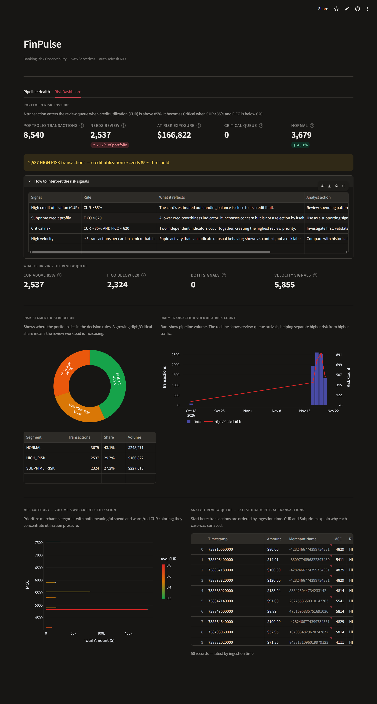
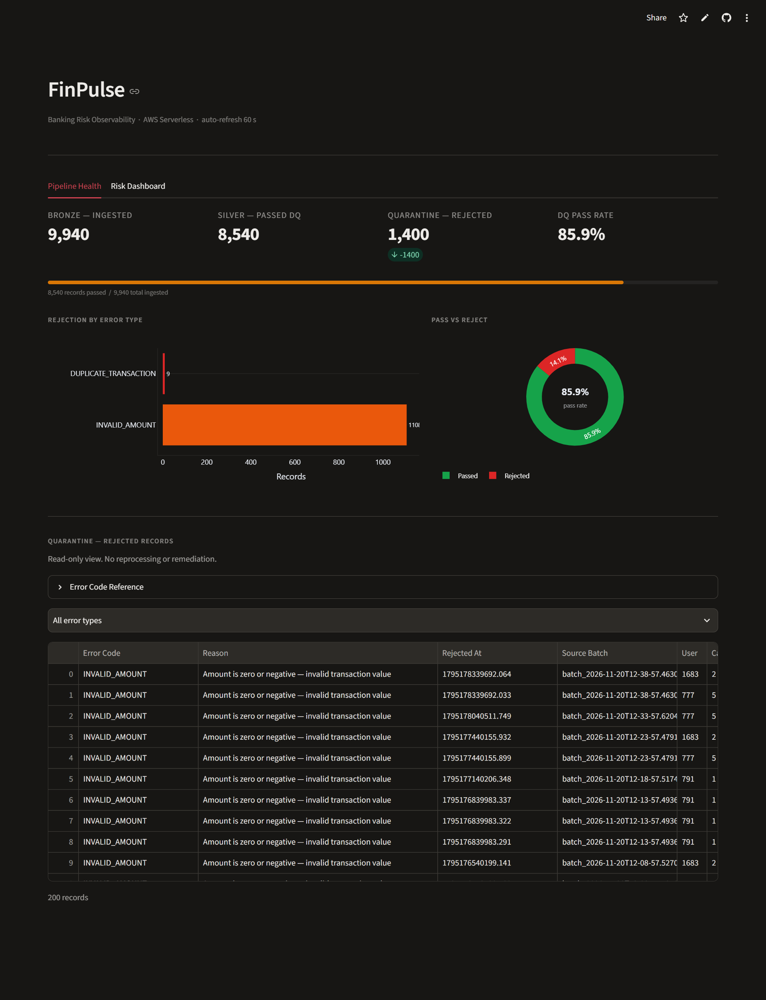

# FinPulse - Transaction Data Quality & Risk Observability

[](https://www.python.org/)
[](https://aws.amazon.com/)
[](https://duckdb.org/)
[](https://streamlit.io/)
[](LICENSE)

**Live dashboard:** [finpulse-banking-pipeline-v01.streamlit.app](https://finpulse-banking-pipeline-v01.streamlit.app)

FinPulse is a **serverless micro-batch data pipeline** for banking-card transaction observability. It reads a small, timestamp-ordered batch of synthetic transactions, applies technical and business data-quality checks, preserves rejected records in a quarantine area, and publishes an analyst-facing dashboard.

The project is an educational prototype for **data quality, auditability, and rule-based review prioritisation**. It is **not** a production banking system, a fraud model, or an automated credit-decision engine.

## Why this project

Transaction pipelines need more than a successful file load. Teams need to know which records were accepted, why a record was rejected, and which accepted records deserve review first.

FinPulse demonstrates that workflow end to end:

- ingest only the next small batch instead of replaying the full dataset;
- separate valid records from invalid records without discarding the latter;
- retain error codes and the source batch for audit and debugging;
- attach transparent FICO/CUR review signals to accepted transactions; and
- expose pipeline health, quarantine reasons, and review queues in a dashboard.

## Architecture

```text
IBM synthetic transaction CSVs
          |
          | one-time conversion and upload
          v
Amazon S3 /raw
  users.parquet | cards.parquet | transactions.parquet
          |
          | EventBridge Scheduler (rate: 5 minutes)
          v
Lambda container: one orchestrated micro-batch cycle
          |
          +--> Producer
          |      reads next N timestamp-ordered rows using saved S3 state
          |      writes bronze/batch_*.parquet
          |
          +--> Tier 1 DQ gate
          |      nulls, invalid amounts, future timestamps, duplicates
          |
          +--> Tier 2 business gate
          |      credit-limit check + FICO/CUR enrichment
          |
          +--> Silver accepted records  --------> S3 /silver
          |            |
          |            +------------------------> S3 /quarantine (JSON + error code)
          |
          +--> Analytics writer ---------------> S3 /gold (partitioned Parquet + dimensions)
                                                     |
                                                     v
                                      Streamlit dashboard with DuckDB S3 queries
```

The deployed path uses **one Lambda container**. Its orchestrator runs producer, DQ gate, and analytics sequentially in a single invocation. This keeps the prototype easy to trace while retaining the logical stage boundaries.

## Data layers

| Layer | Storage | Purpose |
| --- | --- | --- |
| Raw | `s3://<bucket>/raw/` | Source users, cards, and timestamp-sorted transactions in Parquet. |
| Bronze | `bronze/` | Immutable micro-batch output before validation. |
| Silver | `silver/` | Records that passed Tier 1 and Tier 2 checks. |
| Quarantine | `quarantine/` | Rejected records, error code, rejection time, and source Bronze key. |
| Gold | `gold/year=<year>/month=<month>/` | Accepted fact records for dashboard queries, plus supporting dimension extracts. |
| State | `state/state.json` | Last processed timestamp and running processed-row count. |

## Data-quality and review rules

### Tier 1 - technical data quality

| Error code | Rule | Result |
| --- | --- | --- |
| `NULL_CRITICAL_FIELD` | `User`, `Card`, or `Amount` is null | Quarantine |
| `INVALID_AMOUNT` | Amount is zero or negative | Quarantine |
| `FUTURE_TIMESTAMP` | Transaction timestamp is later than ingestion time | Quarantine |
| `DUPLICATE_TRANSACTION` | Composite transaction ID already exists in Gold | Quarantine |

### Tier 2 - business validation and review signals

| Rule / signal | Logic | Result |
| --- | --- | --- |
| `EXCEEDS_CREDIT_LIMIT` | One transaction amount exceeds its card credit limit | Quarantine |
| High CUR | Monthly accepted-spend proxy / credit limit is greater than 85% | `HIGH_RISK` review signal |
| Subprime FICO | FICO score is below 620 | `SUBPRIME_RISK` review signal |
| Dual-factor risk | CUR > 85% **and** FICO < 620 | `CRITICAL_RISK` review signal |
| High velocity | More than 3 transactions for a card in the same replayed micro-batch | Dashboard context only; not a risk label by itself |

### How CUR is calculated

FinPulse uses a **monthly accepted-spend proxy**, not an actual bank statement balance:

```text
CUR = (accepted spending already written to Gold for the same user-card-month
       + current transaction amount)
      / card credit limit
```

FICO is read from the customer dimension and credit limit from the card dimension. The combined FICO/CUR rule is a transparent way to prioritise analyst review; it does not predict default or decide whether a transaction should be declined.

## Dataset

The project uses the synthetic IBM Credit Card Transactions dataset published on [Kaggle](https://www.kaggle.com/datasets/ealtman2019/credit-card-transactions). It contains relational customer, card, and transaction data:

- `sd254_users.csv` - customer attributes, including `FICO Score`;
- `sd254_cards.csv` - card attributes, including `Credit Limit`; and
- `credit_card_transactions-ibm_v2.csv` - timestamped card transactions, merchant information, and an `Is Fraud?` label.

`Is Fraud?` is retained as a source attribute but is **not** used as the target of the FICO/CUR review rules. FinPulse's risk labels are deterministic business-rule signals, not supervised fraud or default predictions.

## Dashboard

### Risk review dashboard



### Pipeline health and quarantine



The Streamlit dashboard has two views:

- **Pipeline Health** - Bronze/Silver counts, DQ pass rate, rejection distribution, and a filterable quarantine viewer.
- **Risk Dashboard** - risk-segment distribution, review-queue drivers, daily volume, merchant-category patterns, and the latest high/critical review records.

The dashboard reads S3-backed Parquet/JSON with DuckDB and caches query results for 60 seconds.

## Local setup

### Prerequisites

- Python 3.11+
- An S3 bucket and AWS credentials with access to it
- The three IBM dataset CSV files placed in `data/`

### 1. Install dependencies

```bash
git clone https://github.com/KANH12/finpulse-banking-pipeline.git
cd finpulse-banking-pipeline

python -m venv .venv
.venv\Scripts\activate  # Windows PowerShell
pip install -r requirements.txt
```

### 2. Configure environment variables

Create `.env` in the repository root. Do not commit it.

```dotenv
AWS_ACCESS_KEY_ID=...
AWS_SECRET_ACCESS_KEY=...
AWS_REGION=ap-southeast-2
S3_BUCKET=finpulse-lake
BATCH_SIZE=10
```

### 3. Prepare the raw layer once

This converts CSV inputs to Parquet, sorts transactions by timestamp, uploads the three source tables, and creates the processing state file.

```bash
python scripts/setup_raw.py
```

### 4. Run one micro-batch locally

```bash
python run_pipeline.py
```

The runner executes one full cycle: **Producer -> DQ Gate -> Analytics**. Run it again to advance to the next batch.

### 5. Open the dashboard

```bash
streamlit run src/dashboard/app.py
```

## Testing

Run the test suite with:

```bash
pytest -q
```

The tests cover state progression, producer behavior, detection flags, Tier 1 routing, Tier 2 risk labels and over-limit rejection, analytics output, and orchestrator ordering/exhaustion behavior.

## AWS deployment

The repository includes a Lambda container image and deployment helpers.

```bash
# Build and push the image after setting the ECR URI in the environment.
python scripts/push_ecr_image.py

# Create or update the Lambda container and its five-minute EventBridge schedule.
python scripts/deploy_aws.py
```

The deploy script configures a batch size of 10 and a `rate(5 minutes)` EventBridge Scheduler expression. Review IAM permissions and image URI before running it in your AWS account.

## Limitations

- The dataset is synthetic; results should not be interpreted as real customer behaviour.
- CUR is a monthly spending proxy because statement balances and payment history are unavailable.
- FICO/CUR rules are explainable review signals, not calibrated probability-of-default or fraud models.
- High velocity is limited to one replayed micro-batch and should not be treated as a full behavioural model.
- The single-Lambda orchestration is intentionally simple; independently scalable services would be appropriate in a production system.

## Repository structure

```text
src/
  producer/        # Next-batch reader, detection flags, state management
  pipeline/        # Tier 1 and Tier 2 DQ gates, Silver and Quarantine writers
  analytics/       # Gold fact/dimension materialisation
  orchestrator/    # Sequential Lambda entry point
  dashboard/       # Streamlit application and DuckDB query layer
  config/          # Settings, logging, AWS clients
scripts/
  setup_raw.py     # One-time CSV -> Parquet -> S3 raw setup
  deploy_aws.py    # Lambda + EventBridge Scheduler deployment
  export_flagged_records.py
tests/             # Unit and integration-oriented tests
```

## Author

Le Nguyen Bao Khang<br>
GitHub: [@KANH12](https://github.com/KANH12) · [LinkedIn](https://linkedin.com/in/khang-le-310131329)
